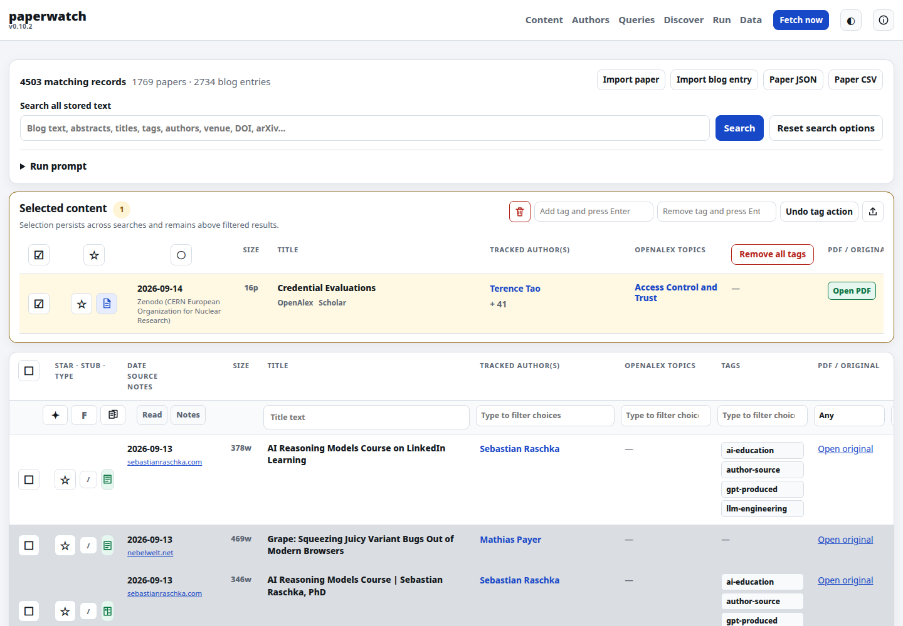
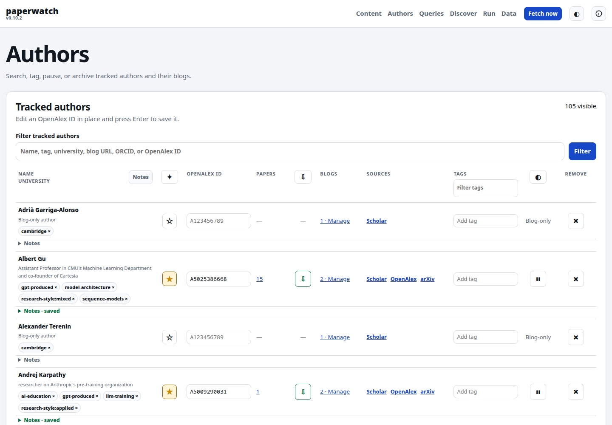
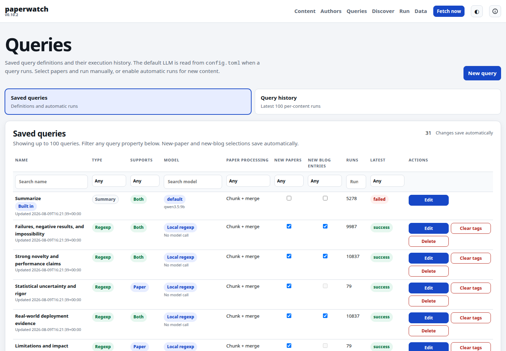
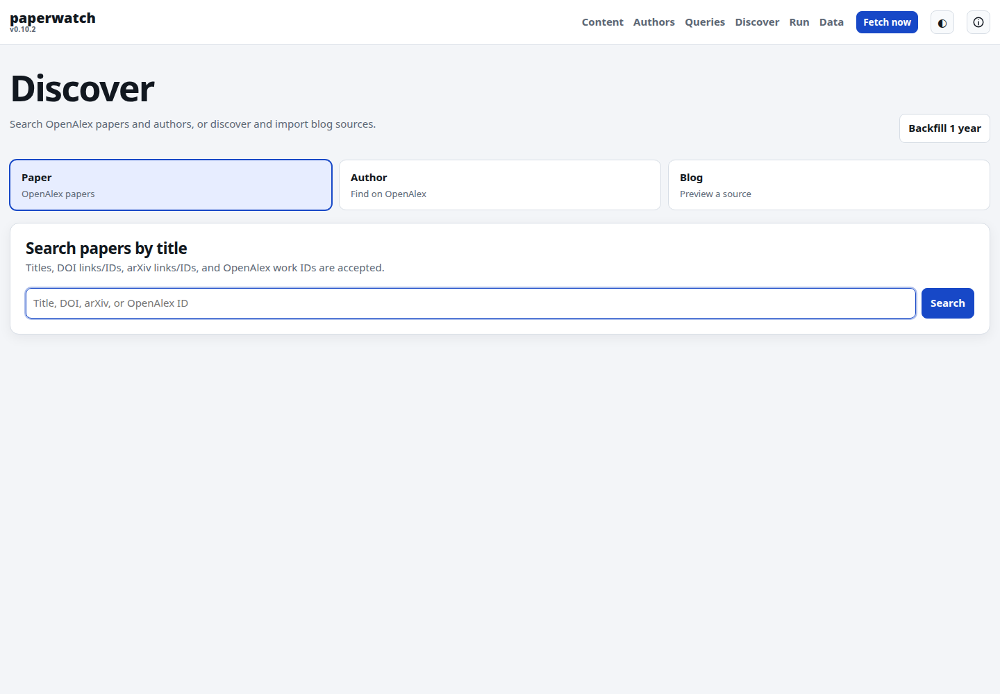
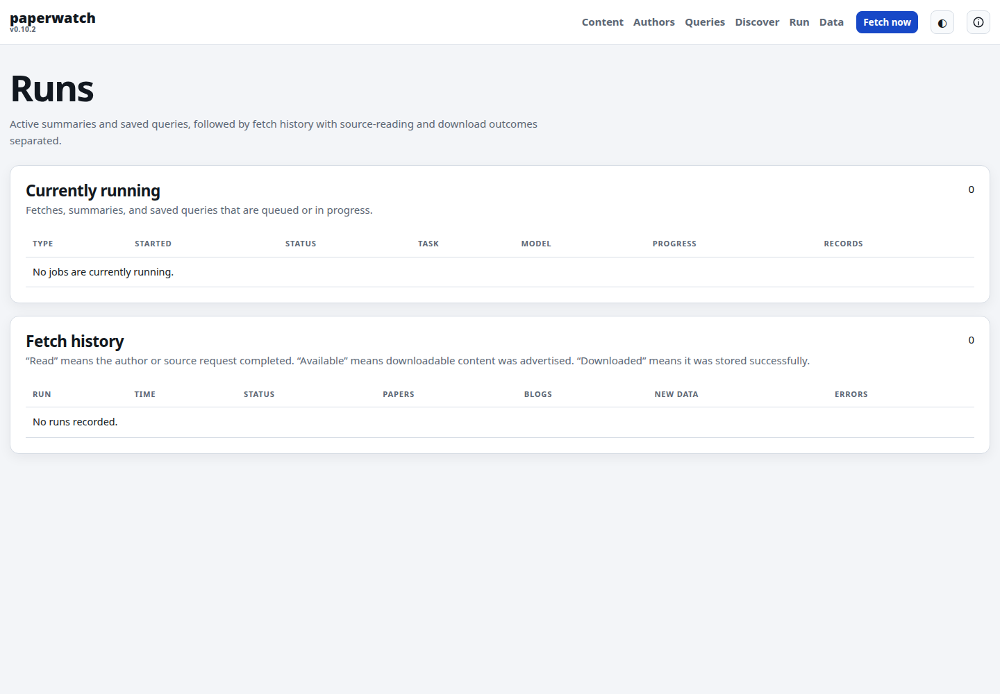
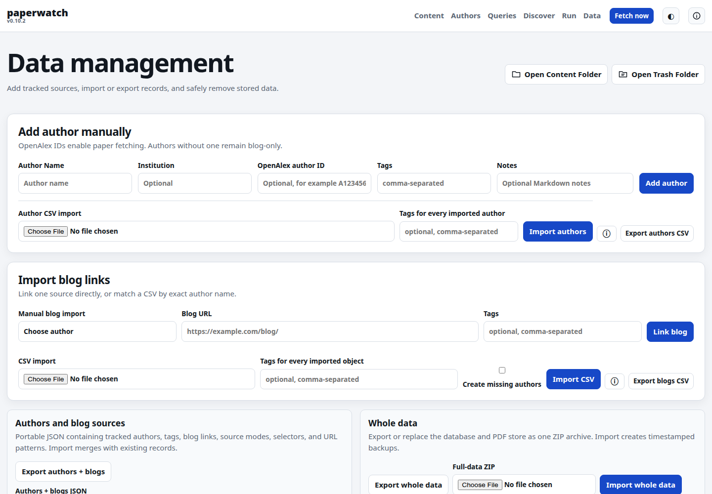

# Paperwatch

Paperwatch is a local research feed for following authors, papers, and technical blogs. It finds new work through OpenAlex and arXiv, archives available PDFs, tracks meaningful blog changes, and can run reusable prompts with Ollama, OpenAI, Codex CLI, or Claude Code.

Everything is stored locally in SQLite and presented in a browser-based interface.

> [!IMPORTANT]
> **AI disclosure:** this is a very vibecoded project. Large parts of Paperwatch were designed and implemented with AI assistance. It is useful, usable, and built for real daily use, but it is not necessarily stable. Expect rough edges, occasional breaking changes, and migrations that have seen less real-world testing than a conventional production application. Keep backups of data you care about and review changes before upgrading.

## Contents

- [Paperwatch](#paperwatch)
  - [Contents](#contents)
  - [Showcase](#showcase)
  - [Features](#features)
  - [Quickstart](#quickstart)
    - [Linux](#linux)
    - [macOS](#macos)
    - [Windows](#windows)
  - [Configure Paperwatch](#configure-paperwatch)
  - [First run](#first-run)
  - [Run automatically](#run-automatically)
  - [Documentation](#documentation)
  - [License](#license)

## Showcase

The six top-level menus cover the complete workflow.

| Content | Authors |
| --- | --- |
| [](docs/images/content.png) | [](docs/images/authors.png) |
| **Queries** | **Discover** |
| [](docs/images/queries.png) | [](docs/images/discover.png) |
| **Run** | **Data** |
| [](docs/images/run.png) | [](docs/images/data.png) |

## Features

- Follow a curated list of researchers and their personal, lab, or company blogs.
- Discover papers through OpenAlex, enrich them with arXiv metadata, and deduplicate by stable identifiers.
- Download and archive openly available PDFs without bypassing paywalls or authentication.
- Read papers and blog updates in one searchable, filterable feed.
- Organize content and authors with tags, stars, read state, notes, and saved selections.
- Generate structured summaries from abstracts or complete papers.
- Run saved prompts and regexp classifiers across selected content or every new fetch.
- Use local Ollama models, the OpenAI API, an authenticated Codex CLI, Claude Code, or no model at all.
- Import individual PDFs, authors, and blog sources; export CSV, JSON, JSONL, or a complete backup archive.
- Keep failures isolated to one author, source, paper, or model job.
- Use light, dark, or system theme settings from a responsive local Web UI.

## Quickstart

Paperwatch requires Python 3.11 or newer, Git, and an [OpenAlex API key](https://openalex.org/settings/api). An LLM is optional.

### Linux

Install Python and Git with your distribution's package manager. For Debian or Ubuntu:

```bash
sudo apt install python3 python3-venv git
git clone https://github.com/tebe-nigrelli/paperwatch-webui.git
cd paperwatch-webui
python3 -m venv .venv
.venv/bin/python -m pip install -e .
.venv/bin/paperwatch init config.toml
```

### macOS

Install [Homebrew](https://brew.sh/) first, then:

```bash
brew install python git
git clone https://github.com/tebe-nigrelli/paperwatch-webui.git
cd paperwatch-webui
python3 -m venv .venv
.venv/bin/python -m pip install -e .
.venv/bin/paperwatch init config.toml
```

### Windows

Install Python 3.11+ from [python.org](https://www.python.org/downloads/windows/) and Git from [git-scm.com](https://git-scm.com/download/win). In PowerShell:

```powershell
git clone https://github.com/tebe-nigrelli/paperwatch-webui.git
cd paperwatch-webui
py -3.11 -m venv .venv
.\.venv\Scripts\python.exe -m pip install -e .
.\.venv\Scripts\paperwatch.exe init config.toml
```

If PowerShell blocks activation scripts, do not change its policy-use the explicit `.venv\Scripts\...` commands shown above.

## Configure Paperwatch

`paperwatch init` creates `config.toml` and the default analysis prompt. The generated file contains every setting; this is the smallest useful configuration to understand:

```toml
[paths]
database = "paperwatch.db"
pdf_dir = "data/pdfs"
prompt = "prompts/analyze.txt"

[openalex]
api_key = "" # Prefer the OPENALEX_API_KEY environment variable

[fetch]
initial_lookback_days = 365
overlap_days = 30
download_pdfs = true

[llm]
provider = "none"
model = ""
```

Start with `provider = "none"` if you only want discovery, downloads, and the local library. You can enable summaries later:

<details>
<summary>Ollama (local models)</summary>

Install [Ollama](https://ollama.com/), then run:

```bash
ollama pull qwen3:8b
```

Use this configuration:

```toml
[llm]
provider = "ollama"
model = "qwen3:8b"
base_url = "http://localhost:11434"
context_window_tokens = 16384
```

</details>

<details>
<summary>OpenAI API</summary>

Set `OPENAI_API_KEY` in your environment and configure a model supported by your account:

```toml
[llm]
provider = "openai"
model = "YOUR_SUPPORTED_MODEL"
base_url = "https://api.openai.com/v1"
context_window_tokens = 32768
```

</details>

<details>
<summary>Codex CLI or Claude Code</summary>

Install and sign in to the corresponding CLI once. Paperwatch reuses its local login; no API key is required.

```toml
[llm]
provider = "codex" # or "claude-code"
model = ""         # Codex may use its authenticated default
command = "codex"  # use "claude" for Claude Code
reasoning_effort = "high"
context_window_tokens = 400000
```

</details>

Set the API key only for the current terminal:

```bash
export OPENALEX_API_KEY='your-key'       # Linux and macOS
```

```powershell
$env:OPENALEX_API_KEY='your-key'         # Windows PowerShell
```

Do not commit `config.toml` or API keys. The repository already ignores the local config, database, PDFs, and environment files.

## First run

Start the local Web UI:

```bash
# Linux and macOS
.venv/bin/paperwatch --config config.toml web
```

```powershell
# Windows PowerShell
.\.venv\Scripts\paperwatch.exe --config config.toml web
```

Open <http://127.0.0.1:8765>, then:

1. Add researchers from **Discover → Author**, or add an author manually from **Data**.
2. Attach blog sources from an author's **Manage** link if wanted.
3. Select **Fetch now**.
4. Browse the combined paper and blog feed under **Content**.
5. Create reusable prompts under **Queries** when you are ready to add model processing.

The server listens only on localhost by default and has no login system. Do not expose it directly to the internet.

## Run automatically

There are two separate processes:

- `paperwatch ... web` keeps the local interface available.
- `paperwatch ... run` performs one fetch and exits, which makes it suitable for a daily scheduler.

Ready-to-copy setup guides are provided for each operating system:

- [Linux: systemd user services and daily timer](docs/SERVICE_SETUP.md#linux-systemd)
- [macOS: launchd agents](docs/SERVICE_SETUP.md#macos-launchd)
- [Windows: Startup and Task Scheduler](docs/SERVICE_SETUP.md#windows-task-scheduler)

The Linux units included in [`systemd/`](systemd/) run the Web UI at login, fetch daily, catch missed runs, and add a randomized delay of up to 30 minutes.

## Documentation

- [Detailed reference](docs/REFERENCE.md) - UI behavior, fetching, PDF handling, model profiles, full-text processing, CLI, data model, exports, and troubleshooting.
- [Service setup](docs/SERVICE_SETUP.md) - automatic Web UI startup and daily fetching on Linux, macOS, and Windows.
- [Testing guide](TESTING.md) - offline test suite and coverage expectations.
- [Audit notes](AUDIT.md) - implementation and release audit details.
- [`config.example.toml`](config.example.toml) - complete configuration example.

## License

[MIT](LICENSE)
